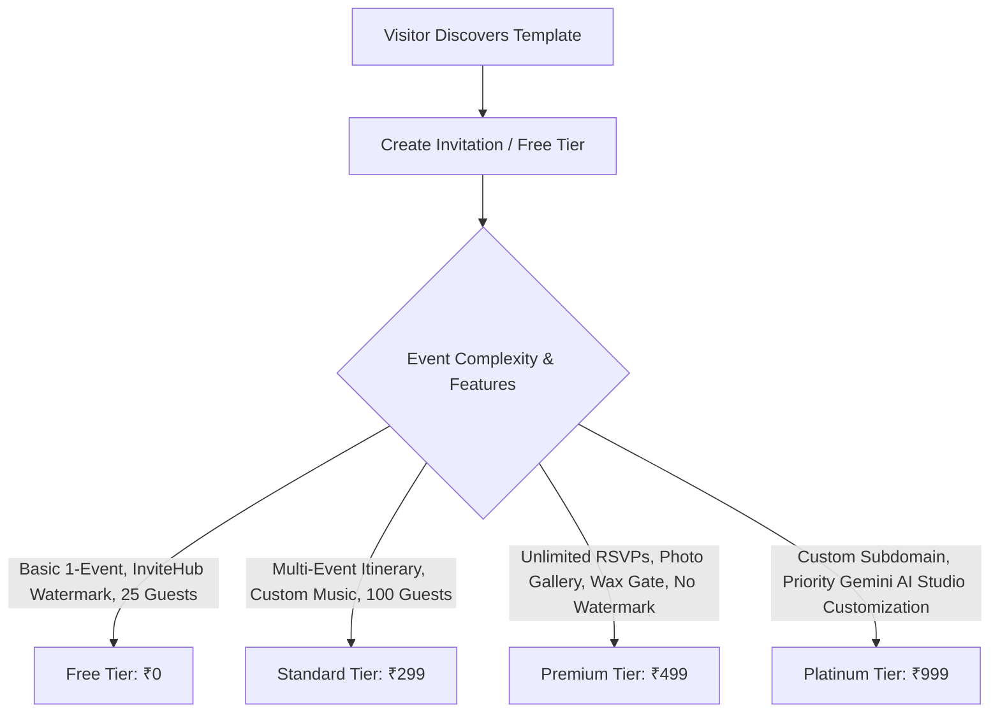

# 01. Project Overview & Product Vision

> **Document Version:** 1.0.0  
> **Author:** Senior Project Manager (PM)  
> **Status:** Approved Baseline  
> **Applicable Environment:** All Tiers (Free, Standard, Premium, Platinum)

---

## 1. Executive Summary

**InviteHub** is a next-generation event website and digital invitation platform engineered to deliver high-end, immersive digital celebration experiences. Modern couples, families, and corporate event planners increasingly demand more than a static PDF card or generic WhatsApp image: they require interactive, mobile-optimized microsites that convey elegance, celebrate cultural richness, streamline guest management, collect RSVPs, and coordinate event logistics across multi-day celebrations.

While existing international platforms (Paperless Post, Joy, Greenvelope) cater primarily to Western single-day weddings, they fail to support the rich cultural traditions, multi-function itineraries (e.g., Haldi, Mehndi, Sangeet, Anand Karaj, Reception, Sunset Cocktails), diverse dietary accommodations, and single-celebrant occasions (Milestone Birthdays, Baby Showers, Housewarmings) prominent in modern events. InviteHub fills this market gap by delivering culturally aware luxury themes, dynamic AI-assisted template generation, seamless mobile animations, and complete host event management tools.

---

## 2. Product Vision & Mission Statement

### Mission
To transform invitation delivery from a static notification into an unforgettable, interactive celebration prelude that honors cultural heritage, delights guests, and simplifies event organization for hosts.

### Vision
To become the premier global event micro-experience platform, empowering any host or event planner to generate a bespoke, publication-ready event website in seconds using natural language, backed by comprehensive RSVP, guest tracking, and interactive celebration features.

---

## 3. Business Model & Monetization Strategy

### 3.1 Historical Transition: From Subscription to Hybrid Pay-Per-Event
Early iterations of the project explored recurring SaaS subscriptions (e.g., monthly or annual plans). However, user research and event industry economics revealed that weddings, milestone birthdays, and celebrations are episodic, high-intent transactions. Users are reluctant to commit to recurring subscriptions for one-time events.

Consequently, InviteHub transitioned to a **Hybrid Pay-Per-Event Model** coupled with premium upsells:



### 3.2 Pricing Tiers & Feature Packaging

| Feature Dimension | Free Tier (₹0) | Standard (₹299) | Premium (₹499) | Platinum (₹999) |
|---|---|---|---|---|
| **Occasion Support** | All Occasions | All Occasions | All Occasions | All Occasions |
| **Active Duration** | 30 Days post-event | 6 Months post-event | 1 Year post-event | Permanent Archive |
| **Guest RSVP Capacity** | 25 Guests | 100 Guests | 500 Guests | Unlimited |
| **Multi-Day Itinerary** | 1 Event | Up to 3 Events | Unlimited Events | Unlimited Events |
| **Interactive Sealed Gate** | Basic Ribbon | Wax Seal (Standard) | Luxury Custom Monogram | 3D Physical Mockup & Video |
| **Background Music** | Default Selection | Custom Audio Upload | Custom Audio Upload | Custom Audio & Playlist |
| **Photo & Video Gallery** | Up to 5 Photos | Up to 25 Photos | Up to 100 Photos | High-Res Video & Unlimited Photos |
| **Platform Branding** | "Powered by InviteHub" | Discreet Footer | No Branding (White-Label) | Custom Domain / Subdomain |
| **AI Customization** | Standard Presets | Standard Presets | Gemini AI Assistance | Full Lovable-Mode Studio Access |
| **Payment Gateway** | N/A | Razorpay UPI / Cards | Razorpay UPI / Cards | Razorpay UPI / Netbanking / Int'l |

---

## 4. Market Positioning & Competitive Advantage

### 4.1 Competitive Landscape

```
                     HIGH LUXURY / BESPOKE
                               ▲
                               │     ★ InviteHub (Multi-occasion,
                               │        AI Studio, Cultural themes,
                               │        Wax-sealed micro-apps)
              Joy / Zola       │
               (Western-heavy) │
                               │     Paperless Post
                               │     (Static cards, high cost)
◄──────────────────────────────┼──────────────────────────────►
STATIC TEMPLATES               │                  RICH INTERACTIVITY
                               │
               Canva / Evite   │
             (Do-It-Yourself)  │     Greenvelope
                               │
                               ▼
                      MASS MARKET / BASIC
```

### 4.2 Key Differentiators
1. **Interactive Opening Experiences:** Rather than loading a dull webpage, guests encounter an interactive digital envelope or wax-sealed royal scroll that opens with authentic haptic-style animations and background audio.
2. **Multi-Occasion Fluid Architecture:** Unlike wedding-only builders, InviteHub dynamically adapts templates across 9 occasion categories (Wedding, Birthday, Anniversary, Baby Shower, Housewarming, Engagement, Cocktail/Party, Religious, Festival).
3. **Admin AI Template Studio ("Lovable Mode"):** Platform administrators can import or create new template products in seconds by describing a visual theme to Google Gemini 2.5 Flash, which configures typography, color tokens, layout archetypes, and showcase data in real time.
4. **Mobile-First Luxury Viewports:** Over 92% of invitation links are opened on mobile devices via WhatsApp, iMessage, and Instagram. Every theme is designed and rendered strictly within an edge-to-edge mobile-optimized frame.
5. **Cultural Richness & Heritage Presets:** Tailored templates celebrate regional traditions (Royal Rajputana, Punjabi Phulkari, South Indian Marigold Temple, Goan Coastal, Modern Minimalist, Art Deco Speakeasy).

---

## 5. Target Personas & Value Proposition

### 5.1 The Host (Primary Customer)
* **Profile:** Couples, parents, or event hosts planning celebrations who want to impress guests without hiring a bespoke web development agency.
* **Pain Points:** Traditional printed cards are slow, expensive, and cannot collect RSVPs. Standard digital cards are boring and lack emotional impact.
* **Value Delivered:** Publish a luxury celebration website in under 5 minutes; share via WhatsApp; track real-time RSVP confirmations and dietary requirements.

### 5.2 The Guest (End Consumer)
* **Profile:** Family member, friend, or colleague receiving the invitation link on their smartphone.
* **Pain Points:** Losing track of event dates, searching WhatsApp chats for venue locations, cumbersome RSVP phone calls.
* **Value Delivered:** High-emotion unboxing experience; 1-click Google Maps directions; instant calendar export (`.ics`); effortless 20-second RSVP submission.

### 5.3 The Platform Administrator / Content Creator
* **Profile:** InviteHub business owner or template designer managing the template catalog.
* **Pain Points:** Writing custom React code for every new theme is slow and developer-dependent.
* **Value Delivered:** Use the AI Template Studio to brainstorm, adjust palettes, tweak event itineraries, and publish directly to the live catalog without engineering redeployments.

