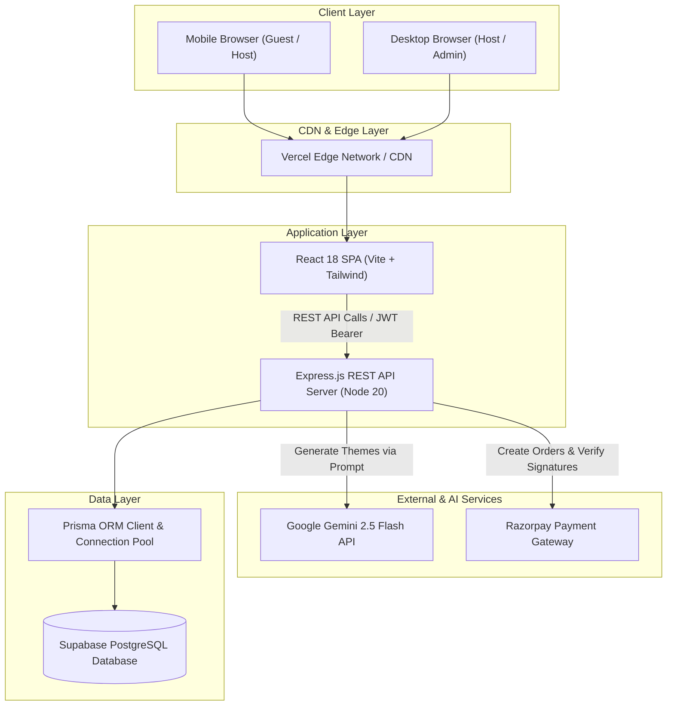
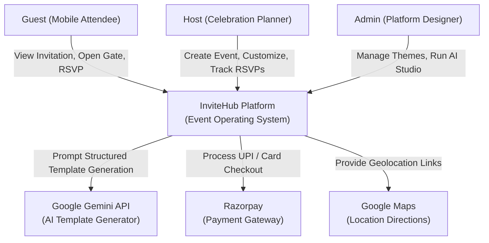
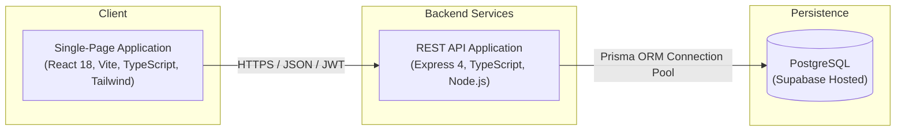

# 05. System Architecture & Technical Design

> **Document Version:** 1.0.0  
> **Author:** Senior Technical Architect  
> **Status:** Approved Baseline  
> **Architecture Pattern:** Decoupled Monorepo (React SPA + Express REST API + PostgreSQL)

---

## 1. High-Level Architectural Overview

InviteHub is architected as a modern, decoupled web application optimized for ultra-fast mobile rendering, developer velocity, and horizontal scalability.



---

## 2. C4 Architecture Specification

### 2.1 Level 1: System Context Diagram
The System Context defines the boundary of InviteHub and how users and external services interact with it:



### 2.2 Level 2: Container Diagram
The Container Diagram breaks down the software deliverables comprising the platform:



### 2.3 Level 3: Frontend Component Architecture

The frontend follows a domain-driven component organization:

```
web/src/
├── components/          # Reusable UI primitives
│   ├── InteractiveSealedGate.tsx # Wax seal unboxing experience
│   ├── EventSchedule.tsx         # Multi-event itinerary with map links
│   ├── RsvpModal.tsx             # Guest RSVP form with validation
│   ├── Navbar.tsx                # Context-aware navigation
│   └── Footer.tsx                # Brand footer
├── pages/               # Top-level view containers
│   ├── LandingPage.tsx           # Marketing showcase & pricing
│   ├── TemplateGallery.tsx       # Searchable catalog
│   ├── TemplatePreview.tsx       # Pre-creation previewer
│   ├── PublicInvitation.tsx      # Public guest micro-app
│   ├── HostDashboard.tsx         # Host control center
│   ├── CreateInvitation.tsx      # Wizard step-machine
│   ├── EditInvitation.tsx        # Split-screen live customizer
│   ├── GuestManager.tsx          # RSVP and seating planner
│   ├── AdminDashboard.tsx        # Business analytics
│   └── AdminTemplateStudio.tsx   # AI Copilot Lovable studio
├── templates/           # 16 Archetype Components & Dynamic Resolver
│   ├── registry.ts               # Component lookup dictionary
│   ├── catalog.tsx               # Curated theme manifests
│   └── components/               # Concrete React theme implementations
└── services/            # External API adapters
    ├── api.ts                    # Axios / Fetch client with auth interceptor
    └── gemini.ts                 # Direct AI completion bindings
```

---

## 3. Template Resolution Architecture

To allow hundreds of unique visual themes without maintaining hundreds of bloated React components, InviteHub utilizes an **Archetype-Manifest Pattern**:

```
Theme Manifest (JSON in DB / catalog.tsx)
  ├── Colors (primary, secondary, background, text, accent)
  ├── Fonts (heading, body, cursive)
  ├── Metadata (occasion, tags, tier, price)
  └── Archetype ID (e.g., "CoastalPearlTemplate")
                    │
                    ▼
          Registry Engine (registry.ts)
                    │
                    ▼
       1 of 16 Core Concrete React Components
```

This decoupled architecture allows the **Admin AI Studio** to generate unlimited unique themes simply by instructing Gemini to output color tokens, typography combinations, and decorative styles that hydrate one of the 16 core layout archetypes.

---

## 4. Google Gemini 2.5 Flash Integration Architecture

The AI Template Studio connects directly to Google's Gemini 2.5 Flash model:

```mermaid
sequenceDiagram
    autonumber
    actor Admin as Platform Admin
    participant Studio as AdminTemplateStudio.tsx
    participant API as /api/themes/generate
    participant Gemini as Google Gemini 2.5 Flash
    participant DB as Supabase PostgreSQL

    Admin->>Studio: Enter prompt ("Goan beach birthday party")
    Studio->>API: POST /api/themes/generate (prompt, occasion)
    API->>Gemini: Prompt + System Schema Guidelines
    Note over Gemini: Analyzes mood, picks Coastal archetype,<br/>generates tropical color tokens & sample events
    Gemini-->>API: Structured JSON Theme Specification
    API-->>Studio: Theme Specification JSON
    Note over Studio: React state updates; Phone preview<br/>re-renders with new theme instantly!
    Admin->>Studio: Conversational tweak ("Make gold warmer")
    Studio->>API: Refine Theme Prompt
    API-->>Studio: Updated JSON
    Admin->>Studio: Click "Publish to Catalog"
    Studio->>API: POST /api/themes (theme payload)
    API->>DB: INSERT into Theme table
    DB-->>API: Created record
    API-->>Studio: HTTP 201 Created (Live in Catalog!)
```

---

## 5. Security Architecture

1. **Authentication:** Stateless JSON Web Tokens (JWT) signed with HMAC-SHA256 containing `userId`, `email`, and `role`. Tokens expire after 7 days.
2. **Password Hashing:** Passwords hashed with bcrypt (cost factor 10) before persistence.
3. **Authorization Middleware:**
   * `authenticateToken`: Validates incoming Bearer token on protected routes.
   * `requireAdmin`: Enforces `role === 'ADMIN'` for template creation, theme mutations, and system metrics.
   * `checkInvitationOwnership`: Guarantees that hosts can only read, edit, or delete invitations linked to their own `userId`.
4. **CORS Policy:** Strict domain origin whitelisting in production to block cross-site request forgery.

