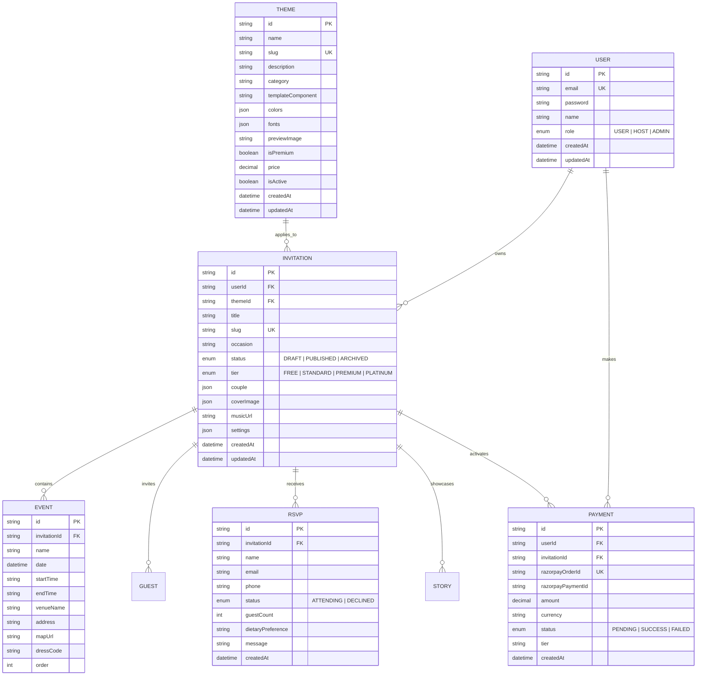

# 06. Database Schema & REST API Specification

> **Document Version:** 1.0.0  
> **Author:** Senior Backend Engineer & Technical Architect  
> **Database:** PostgreSQL (Hosted on Supabase) via Prisma ORM  
> **Base API URL:** `/api` (or `http://localhost:3000/api`)

---

## 1. Prisma Entity-Relationship Model



---

## 2. Relational Schema Data Dictionary

### 2.1 `User`
Primary entity representing all platform actors.
* `id` (`String`, `@id`, `cuid()` / `uuid()`): Unique user identifier.
* `email` (`String`, `@unique`): Normalized user email for authentication.
* `password` (`String`): Bcrypt salted hash (never returned in API responses).
* `name` (`String`): Full display name.
* `role` (`Enum`): `USER`, `HOST`, `ADMIN` (Default: `USER`).

### 2.2 `Theme`
Master product catalog records for template designs.
* `id` (`String`, `@id`): Unique theme ID.
* `name` (`String`): Commercial display name (e.g., "Royal Maroon Palace").
* `slug` (`String`, `@unique`): URL-friendly handle (e.g., `royal-maroon`).
* `category` (`String`): Occasion tag (`wedding`, `birthday`, `anniversary`, etc.).
* `templateComponent` (`String`): Identifier mapping to React archetype in `registry.ts`.
* `colors` (`Json`): Palette tokens (`primary`, `secondary`, `accent`, `background`).
* `fonts` (`Json`): Typography pairings (`heading`, `body`, `accent`).
* `isPremium` (`Boolean`): Requires paid tier upgrade to publish.
* `price` (`Decimal`): Retail price tag for catalog display.
* `isActive` (`Boolean`): Catalog visibility toggle.

### 2.3 `Invitation`
The primary event microsite instance owned by a host.
* `id` (`String`, `@id`): Unique invitation UUID.
* `userId` (`String`, FK -> `User.id`): Creator/owner.
* `themeId` (`String`, FK -> `Theme.id`): Active theme applied.
* `title` (`String`): Event title (e.g., "Aarav's 30th Birthday Bash").
* `slug` (`String`, `@unique`): Public vanity URL path (`/i/:slug`).
* `occasion` (`String`): Specific celebration type.
* `status` (`Enum`): `DRAFT`, `PUBLISHED`, `ARCHIVED`.
* `tier` (`Enum`): `FREE`, `STANDARD`, `PREMIUM`, `PLATINUM`.
* `couple` (`Json`): Honoree data structure:
  * For couples: `{ groom: "Rohan", bride: "Priya" }`
  * For single celebrants: `{ groom: "Aarav Sharma", bride: "" }`
* `settings` (`Json`): Feature toggles (wax seal type, music autoplay, RSVP enabled).

### 2.4 `Event`
Sub-event itinerary entries linked to an invitation.
* `id` (`String`, `@id`): Sub-event ID.
* `invitationId` (`String`, FK -> `Invitation.id`): Parent invitation.
* `name` (`String`): Sub-event name (e.g., "Cocktail Reception").
* `date` (`DateTime`): Calendar date of the sub-event.
* `startTime` / `endTime` (`String`): Display timing strings (e.g., "07:00 PM").
* `venueName` (`String`): Name of the hall or resort.
* `address` (`String`): Physical street address.
* `mapUrl` (`String`): Google Maps navigation link.
* `dressCode` (`String`): Attire guidance (e.g., "Indo-Western Black Tie").

### 2.5 `Rsvp`
Guest response record collected from public microsite.
* `id` (`String`, `@id`): Unique RSVP submission ID.
* `invitationId` (`String`, FK -> `Invitation.id`): Associated invitation.
* `name` (`String`): Primary guest name.
* `email` (`String`, optional): Guest email.
* `phone` (`String`, optional): Guest mobile number.
* `status` (`Enum`): `ATTENDING`, `DECLINED`.
* `guestCount` (`Int`): Total head count (including +1s and children).
* `dietaryPreference` (`String`): Selected diet option.
* `message` (`String`): Optional well-wishes note.

---

## 3. REST API Specification

### 3.1 Authentication Endpoints

#### `POST /api/auth/register`
* **Access:** Public
* **Payload:**
  ```json
  {
    "name": "Harpreet Singh",
    "email": "host@example.com",
    "password": "SecurePassword123!"
  }
  ```
* **Success Response (201 Created):**
  ```json
  {
    "token": "eyJhbGciOiJIUzI1NiIsIn...",
    "user": {
      "id": "cuid_12345",
      "name": "Harpreet Singh",
      "email": "host@example.com",
      "role": "USER"
    }
  }
  ```

#### `POST /api/auth/login`
* **Access:** Public
* **Payload:**
  ```json
  {
    "email": "host@example.com",
    "password": "SecurePassword123!"
  }
  ```
* **Success Response (200 OK):**
  ```json
  {
    "token": "eyJhbGciOiJIUzI1NiIsIn...",
    "user": {
      "id": "cuid_12345",
      "name": "Harpreet Singh",
      "email": "host@example.com",
      "role": "USER"
    }
  }
  ```

---

### 3.2 Template Studio & Catalog Endpoints

#### `POST /api/admin/template-studio/generate` (Alias: `/api/themes/generate`)
* **Access:** Admin Only (`role === 'ADMIN'`)
* **Headers:** `Authorization: Bearer <jwt_token>`
* **Payload:**
  ```json
  {
    "prompt": "Create a luxury Punjabi Phulkari wedding theme with golden borders and festive marigold tones",
    "occasion": "wedding",
    "archetypeHint": "PhulkariCelebrationTemplate"
  }
  ```
* **Success Response (200 OK):**
  ```json
  {
    "name": "Phulkari Royal Anand Karaj",
    "slug": "phulkari-royal-anand-karaj",
    "category": "wedding",
    "templateComponent": "PhulkariCelebrationTemplate",
    "colors": {
      "primary": "#880E4F",
      "secondary": "#F57F17",
      "accent": "#FFD54F",
      "background": "#FFFDE7"
    },
    "fonts": {
      "heading": "Cinzel Decorative",
      "body": "Montserrat"
    },
    "description": "Vibrant Punjabi celebration featuring traditional geometric motifs and royal gold embroidery accents."
  }
  ```

---

### 3.3 Invitation Endpoints

#### `POST /api/host/invitations` (Alias: `/api/invitations`)
* **Access:** Authenticated Host
* **Headers:** `Authorization: Bearer <jwt_token>`
* **Payload:**
  ```json
  {
    "themeId": "theme_royal_maroon",
    "title": "Rohan & Priya's Wedding",
    "slug": "rohan-priya-wedding",
    "occasion": "wedding",
    "couple": {
      "groom": "Rohan Kapoor",
      "bride": "Priya Sharma"
    }
  }
  ```
* **Success Response (201 Created):** Full Invitation record with empty events array.

#### `GET /api/public/invitations/:slug` (Alias: `/api/invitations/public/:slug`)
* **Access:** Public (Unauthenticated)
* **Response (200 OK):**
  ```json
  {
    "id": "df2857d6-e851-4083-a680-fff09b764dff",
    "title": "Rohan & Priya's Wedding Celebration",
    "slug": "rohan-priya-wedding",
    "occasion": "wedding",
    "tier": "PREMIUM",
    "couple": {
      "groom": "Rohan Kapoor",
      "bride": "Priya Sharma"
    },
    "theme": {
      "templateComponent": "RoyalMaroonTemplate",
      "colors": { "primary": "#800000", "secondary": "#D4AF37" }
    },
    "events": [
      {
        "id": "evt_01",
        "name": "Sangeet & Cocktails",
        "date": "2027-03-12T18:30:00Z",
        "venueName": "The Grand Hyatt Ballroom",
        "address": "Goa Beach Road",
        "mapUrl": "https://maps.google.com/..."
      }
    ]
  }
  ```

---

### 3.4 RSVP & Payments Endpoints

#### `POST /api/rsvp`
* **Access:** Public
* **Payload:**
  ```json
  {
    "invitationId": "df2857d6-e851-4083-a680-fff09b764dff",
    "name": "Gaurav Malhotra",
    "email": "gaurav@example.com",
    "status": "ATTENDING",
    "guestCount": 2,
    "dietaryPreference": "Vegetarian",
    "message": "Can't wait to celebrate with you both!"
  }
  ```
* **Success Response (201 Created):**
  ```json
  { "success": true, "message": "RSVP recorded successfully." }
  ```

#### `POST /api/payments/create-order`
* **Access:** Authenticated Host
* **Payload:** `{ "invitationId": "inv_123", "tier": "PREMIUM" }`
* **Success Response (200 OK):**
  ```json
  {
    "orderId": "order_NX8y91Z34A",
    "amount": 49900,
    "currency": "INR",
    "keyId": "rzp_test_..."
  }
  ```
