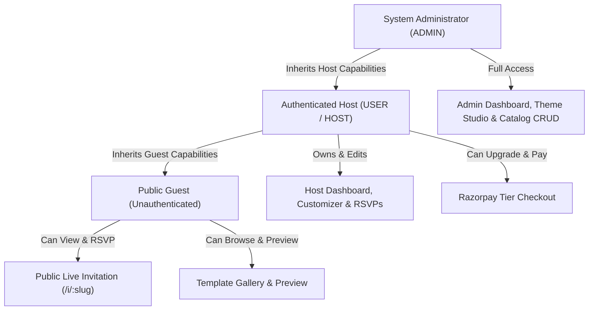

# 07. User Roles, Security & Permission Architecture

> **Document Version:** 1.0.0  
> **Author:** Senior Technical Architect & Security Lead  
> **Status:** Approved Baseline  
> **Security Standards:** OWASP Top 10 Compliant, JWT Bearer Token RBAC

---

## 1. Role-Based Access Control (RBAC) Hierarchy

InviteHub implements a 3-tier hierarchical RBAC model designed to balance frictionless public guest interactions with strict multi-tenant isolation and administrative governance.



---

## 2. Granular Permissions Matrix

| Platform Capability | Public Guest | Authenticated Host | System Admin |
|---|:---:|:---:|:---:|
| **Browse Landing Page & Pricing** | ✅ | ✅ | ✅ |
| **View Template Catalog & Live Previews** | ✅ | ✅ | ✅ |
| **Open Sealed Gate on Public Invitation** | ✅ | ✅ | ✅ |
| **Submit RSVP on Public Invitation** | ✅ | ✅ | ✅ |
| **Register & Authenticate Account** | ✅ | ✅ | ✅ |
| **Access Host Dashboard** | ❌ | ✅ | ✅ |
| **Create New Invitation Draft** | ❌ | ✅ | ✅ |
| **Edit Owned Invitation Content & Events** | ❌ | ✅ (Own Only) | ✅ (All) |
| **Delete Owned Invitation** | ❌ | ✅ (Own Only) | ✅ (All) |
| **Export Owned RSVP List to CSV** | ❌ | ✅ (Own Only) | ✅ (All) |
| **Upgrade Invitation Tier via Razorpay** | ❌ | ✅ (Own Only) | ✅ (All) |
| **Access Admin Master Dashboard** | ❌ | ❌ | ✅ |
| **Create / Modify Theme Database Records** | ❌ | ❌ | ✅ |
| **Use Gemini AI Template Product Studio** | ❌ | ❌ | ✅ |
| **Publish New Theme Directly to Catalog** | ❌ | ❌ | ✅ |
| **View System-Wide User & Revenue Stats** | ❌ | ❌ | ✅ |

---

## 3. Authentication & Token Architecture

### 3.1 Token Lifecycle
1. **Issuance:** On successful invocation of `/api/auth/login` or `/api/auth/register`, the server generates a signed JSON Web Token (JWT).
2. **Payload Structure:**
   ```json
   {
     "userId": "usr_991823746",
     "email": "host@example.com",
     "role": "HOST",
     "iat": 1731828000,
     "exp": 1732432800
   }
   ```
3. **Transport:** Clients transmit the token in the HTTP `Authorization` request header formatted as:
   `Authorization: Bearer <jwt_token>`
4. **Storage:** Stored client-side in `localStorage` under key `invitehub_token`.

### 3.2 Backend Middleware Implementation

#### 1. `authenticateToken`
Intercepts incoming HTTP requests, verifies the HMAC-SHA256 signature using `process.env.JWT_SECRET`, decodes the payload, and attaches `req.user` to the Express Request context.
* Returns `401 Unauthorized` if header is absent or token is malformed.
* Returns `403 Forbidden` if signature is invalid or token has expired.

#### 2. `requireAdmin`
Executes subsequent to `authenticateToken` on administrative routes (`/api/themes/*`, `/api/admin/*`).
* Verifies `req.user.role === 'ADMIN'`.
* Rejects non-admin hosts with `403 Forbidden: Administrative privileges required`.

#### 3. `checkInvitationOwnership`
Guarantees tenant isolation for multi-host databases:
```typescript
const invitation = await prisma.invitation.findUnique({ where: { id: req.params.id } });
if (!invitation) return res.status(404).json({ error: "Invitation not found" });

if (req.user.role !== 'ADMIN' && invitation.userId !== req.user.userId) {
  return res.status(403).json({ error: "Access denied: You do not own this invitation" });
}
```

---

## 4. Security Defenses & Hardening

* **Password Protection:** Minimum 8 characters. Hashed using bcrypt with 10 salt rounds. Plaintext passwords never enter logs or database tables.
* **SQL Injection Prevention:** 100% parameterization achieved via Prisma ORM query builder. Raw SQL queries are prohibited across the application codebase.
* **Cross-Site Scripting (XSS):** React automatically escapes rendered strings. HTML injection within wedding stories or guest messages is sanitized before output.
* **CORS Whitelisting:** Express backend restricts origins in production to designated frontend domains (`https://invitehub.vercel.app`), disallowing arbitrary cross-origin fetch requests.

