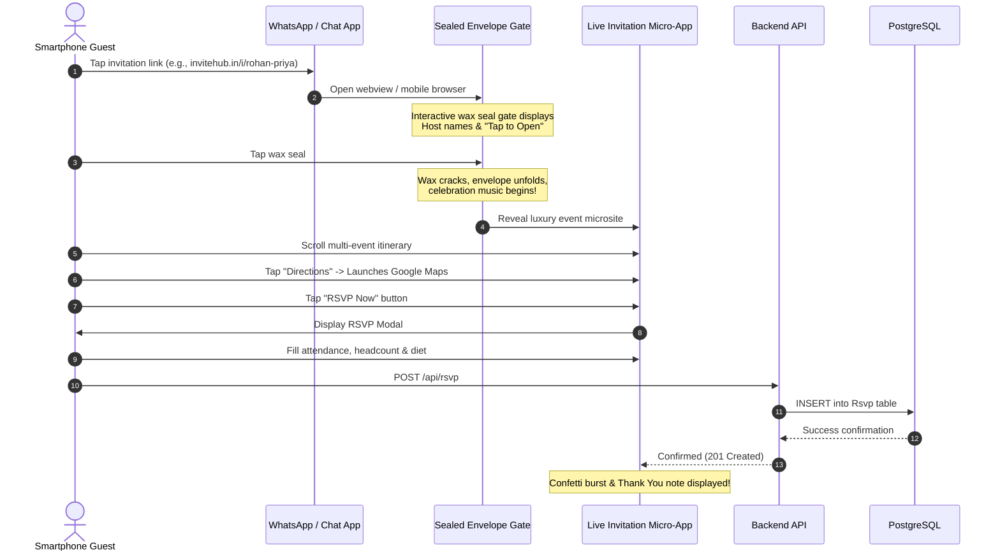
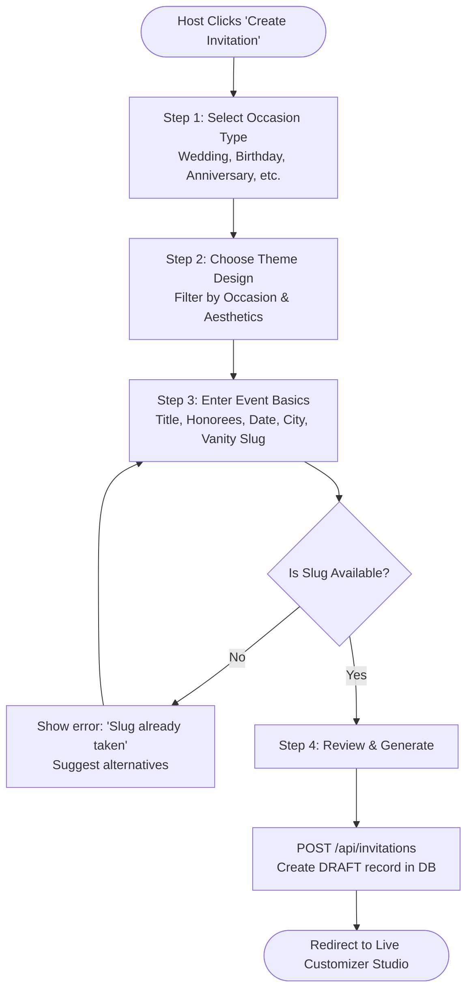
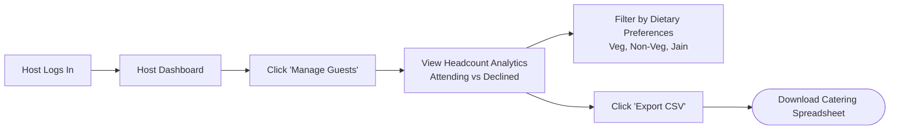
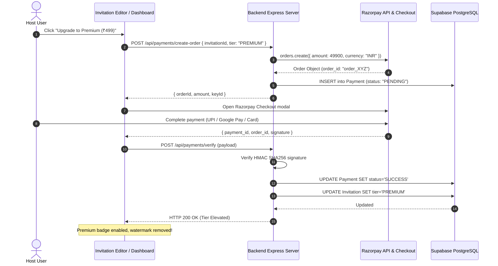

# 08. End-to-End User Workflows

> **Document Version:** 1.0.0  
> **Author:** Senior Project Manager & UX Architect  
> **Status:** Approved Baseline  
> **Audience:** Product Managers, UX Designers, Frontend & QA Engineers

---

## 1. Guest Journey: Unboxing, Itinerary & RSVP

The guest journey is designed for extreme emotional engagement, zero friction, and instant mobile readability. Over 90% of guests access the invitation directly from messaging apps (WhatsApp/iMessage).



---

## 2. Host Journey: Invitation Creation Wizard

The 4-step wizard guides prospective hosts from template selection to a live draft website in under 2 minutes.



---

## 3. Host Journey: Live Customizer Studio Workflow

The Live Customizer Studio provides a split-screen interactive environment where changes immediately reflect in a real-time mobile frame.

```mermaid
stateDiagram-v2
    [*] --> LoadingStudio
    LoadingStudio --> InitializingState: Fetch Invitation by ID
    InitializingState --> EditingActive: Hydrate Form Controls & Phone Preview

    state EditingActive {
        [*] --> GeneralSettings
        GeneralSettings --> ThemeAndColors: Select Palette / Fonts
        ThemeAndColors --> EventItinerary: Add / Edit Sub-events
        EventItinerary --> HonoreeDetails: Adjust Single vs Couple Names
        HonoreeDetails --> MusicAndMedia: Upload Audio / Cover Photo
    }

    EditingActive --> LivePreviewUpdate: Keystroke / Color Change
    LivePreviewUpdate --> EditingActive: Instant React State Re-render

    EditingActive --> SaveDraft: Click "Save Draft"
    SaveDraft --> API_Save: PUT /api/invitations/:id
    API_Save --> EditingActive: Saved notification

    EditingActive --> PublishCheck: Click "Publish Invitation"
    PublishCheck --> TierEvaluation{Is Free Tier or Paid Theme?}
    TierEvaluation -->|Free Eligible| DirectPublish[POST /api/invitations/:id/publish]
    DirectPublish --> LivePublicSite[Site Live at /i/:slug]
    TierEvaluation -->|Requires Upgrade| LaunchCheckout[Open Razorpay Checkout Modal]
    LaunchCheckout --> DirectPublish: Payment Succeeded
```

---

## 4. Host Journey: RSVP Tracking & Guest List Export



---

## 5. Host Journey: Tier Upgrade & Razorpay Checkout



