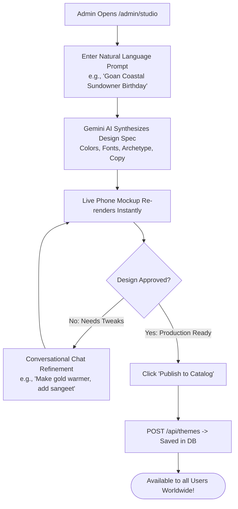
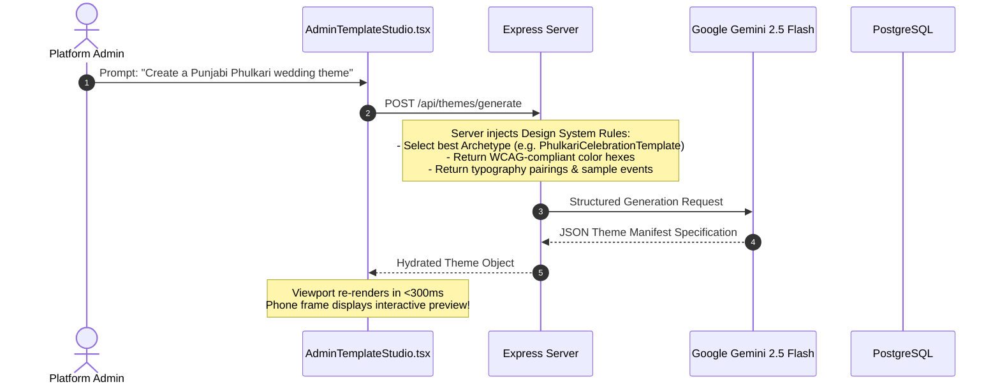

# 09. Admin & AI Template Studio Workflows

> **Document Version:** 1.0.0  
> **Author:** Senior Product Manager & Technical Architect  
> **Target Audience:** Platform Administrators, Designers & Content Engineers  
> **Core Tool:** Admin AI Template Studio (`/admin/studio`)

---

## 1. Executive Admin Workflow Concept

In traditional event platforms, introducing a new theme requires 2–3 weeks of design mockups, frontend HTML/CSS implementation, manual database seeding, and code deployment.

InviteHub eliminates this bottleneck via the **Admin AI Template Studio ("Lovable Mode")**. By leveraging **Google Gemini 2.5 Flash**, an administrator can generate, visually audit, conversationally iterate, and publish a brand new template product to the live commercial catalog in under **60 seconds**, without writing a single line of React code or triggering server redeployments.



---

## 2. Gemini AI Template Generation Engine

### 2.1 The Generation Prompt Flow
When an administrator enters a theme vision into the prompt input, the client dispatches a structured payload to `/api/themes/generate`.



### 2.2 System Design Schema Injected to Gemini
To guarantee that Gemini generates syntactically valid and aesthetically pleasing themes, the backend injects strict archetype constraints:

```typescript
const systemPrompt = `
You are the Lead Creative Director for InviteHub, a luxury invitation platform.
Analyze the user's prompt and output a valid JSON theme specification adhering to this schema:
{
  "name": "Creative Theme Name",
  "slug": "url-friendly-slug",
  "category": "wedding" | "birthday" | "anniversary" | "baby_shower" | "housewarming" | "party",
  "archetype": "RoyalMaroonTemplate" | "PhulkariCelebrationTemplate" | "CoastalPearlTemplate" | "ArtDecoGlamourTemplate" | "GoldenMilestoneTemplate" | "PastelWhimsyTemplate",
  "colors": {
    "primary": "#hex",
    "secondary": "#hex",
    "accent": "#hex",
    "background": "#hex",
    "text": "#hex"
  },
  "fonts": {
    "heading": "Cinzel Decorative" | "Playfair Display" | "Cormorant Garamond" | "Montserrat",
    "body": "Montserrat" | "Inter" | "Lato"
  },
  "couple": {
    "groom": "Primary Honoree Name",
    "bride": "Partner Name (Empty string if single-celebrant occasion)"
  },
  "itinerary": [
    { "name": "Event Title", "time": "07:00 PM", "venue": "Luxury Venue Name", "dressCode": "Attire" }
  ]
}
`;
```

---

## 3. Conversational Iteration ("Lovable Mode")

Once an initial theme is generated on screen, the administrator can refine it conversationally rather than navigating complex CSS panels.

### Supported Conversational Adjustments
* **Palette Alterations:**
  * *"Make the primary color royal emerald green and the accent antique champagne gold."*
  * *"Increase contrast between text and background for better sunlight readability."*
* **Typography Tuning:**
  * *"Switch headings from serif to modern clean geometric sans-serif."*
* **Occasion Re-alignment:**
  * *"This is for a 50th Golden Jubilee Birthday, remove wedding references and change honoree to Vikram Oberoi."*
* **Itinerary Enhancements:**
  * *"Add a Sundowner Beach BBQ event starting at 5 PM at Vagator Beach."*

Every conversational update mutates the active working state and re-renders the live preview within milliseconds, allowing rapid creative iteration.

---

## 4. Theme Publishing & Commercial Catalog Curation

When the administrator is satisfied with the preview:

1. **Click "Publish to Catalog":** The UI triggers a payload dispatch to `/api/themes`.
2. **Database Persistence:**
   * An entry is inserted into the `Theme` table with `isActive: true`.
   * The `templateComponent` field is set to the selected archetype.
   * Color tokens and fonts are saved in the JSON fields.
3. **Immediate Discovery:**
   * The template immediately appears in the public gallery at `/templates`.
   * Prospective hosts can preview and select it in the creation wizard.
4. **Catalog Management (`/admin/themes`):**
   * Administrators can toggle `isActive` to hide seasonal themes (e.g., Diwali or Christmas templates) without deleting data.
   * Edit retail pricing tags (₹299 vs ₹499) and premium badges.

