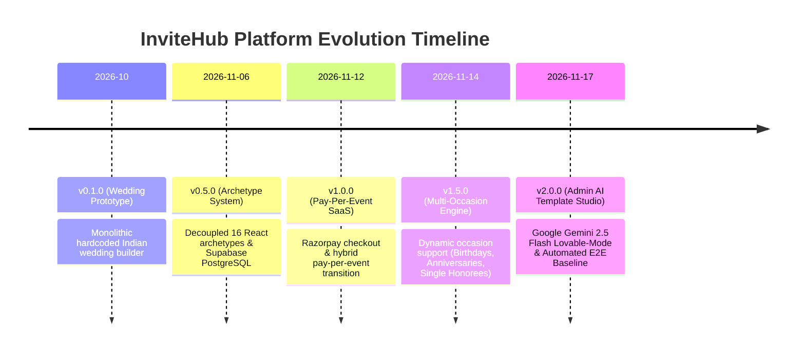

# 20. Comprehensive Platform Change History & Changelog

> **Document Version:** 1.0.0  
> **Author:** Senior Project Manager & Technical Architect  
> **Status:** Approved Baseline  
> **Repository:** `/home/harpreet/E-invetation`

---

## 1. Version Timeline Overview

---

## 2. Detailed Release Changelog

### Version 2.0.0 (November 17, 2026) — *Admin AI Template Studio & Baseline Stabilization*
* **Milestone:** M2 (AI Studio & Occasion Diversity)
* **Key Additions:**
  * **Admin AI Template Studio (`/admin/studio`):** Integrated Google Gemini 2.5 Flash for prompt-driven template generation directly within an interactive iPhone frame mockup.
  * **Conversational Iteration ("Lovable Mode"):** Real-time refinement chat enabling palette, typography, and event schedule mutations without page reloads.
  * **Automated E2E Headless Browser Audit:** 10 core regression test scenarios (TC-PUB-01 to TC-ADM-02) executed with 100% pass rate and photographic proof.
  * **Centralized Documentation System:** Reconciled 45+ legacy markdown files into unified `project-documentation/` repository.
* **Bug Fixes:**
  * Fixed occasion text leakage where birthday prompts displayed "Wedding Invitation" headings.
  * Resolved template registry fallback mismatch for legacy component slugs.
  * Corrected Puppeteer query selector pseudo-syntax in public invitation automated test.

---

### Version 1.5.0 (November 14, 2026) — *Multi-Occasion Platform Transformation*
* **Milestone:** M1 Extension
* **Key Additions:**
  * Expanded platform scope beyond weddings to support 9 celebration categories: Wedding, Birthday, Anniversary, Baby Shower, Housewarming, Engagement, Cocktail/Party, Religious, and Festival.
  * Introduced single-celebrant naming logic (`couple.groom` as primary honoree, omitting `couple.bride`).
  * Added dynamic template heading helper (`getOccasionHeading`).
* **Architecture:**
  * Added occasion filters to `/templates` catalog gallery.
  * Implemented 4-step creation wizard with occasion-first selection step.

---

### Version 1.0.0 (November 12, 2026) — *SaaS Business Model Transition*
* **Milestone:** M1 Core
* **Key Additions:**
  * Abandoned recurring subscription model in favor of **Hybrid Pay-Per-Event** model (Free ₹0, Standard ₹299, Premium ₹499).
  * Integrated Razorpay Payment Gateway SDK for UPI, Netbanking, and Credit Card payments.
  * Implemented `/api/payments/create-order` and `/api/payments/verify` endpoints.
* **Database Migrations:**
  * Added `tier` enum (`FREE`, `STANDARD`, `PREMIUM`, `PLATINUM`) to `Invitation` table.
  * Created `Payment` table for transaction history and Razorpay order reconciliation.

---

### Version 0.5.0 (November 06, 2026) — *Archetype Decoupling & Supabase Migration*
* **Key Additions:**
  * Decoupled monolithic wedding designs into 16 concrete React archetype components in `web/src/templates/components/`.
  * Created `registry.ts` dynamic component resolver.
  * Migrated local development SQLite database to cloud-hosted Supabase PostgreSQL via Prisma ORM.
  * Implemented JWT-based role authentication (`USER`, `HOST`, `ADMIN`).

---

### Version 0.1.0 (October 2026) — *Initial Proof-of-Concept*
* **Key Additions:**
  * Initial proof-of-concept wedding microsite with basic RSVP form and audio player.
  * Hardcoded Royal Maroon theme.

